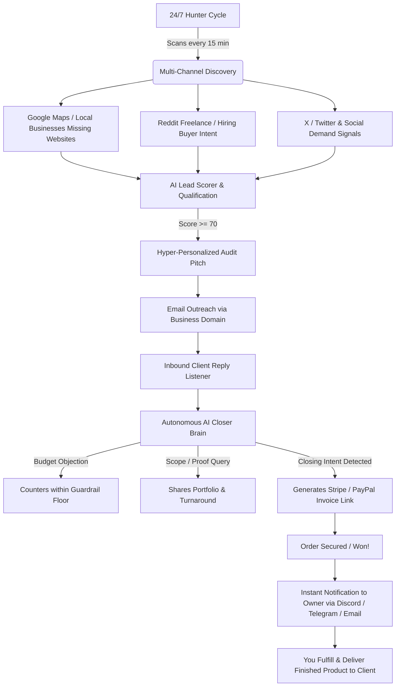

# OmniLead 24/7 | Autonomous Lead Hunter & Deal Closer

An end-to-end autonomous agent designed to run **24/7**, hunting for high-intent client opportunities in **website creation**, **web development**, and **social media automation**, reaching out with personalized audits, negotiating within strict profit guardrails, and closing orders with payment links.

---

## ⚡ How It Works (The 24/7 Flywheel)



---

## 🎯 Target Services & Safeguarded Pricing Catalog

The agent is pre-configured with industry-tested pricing and strict minimum negotiation floors:

| Service Package | List Price | Minimum Floor | Turnaround | Deliverables |
|---|---|---|---|---|
| **High-Converting Landing Page** | **$499** | $399 | 3 days | Mobile-first landing page, SEO, lead capture form |
| **Complete Modern Business Website** | **$1,200** | $950 | 7 days | 5-8 pages, CMS integration, fast animations, analytics |
| **Social Media Automation Engine** | **$650** | $500 | 4 days | Auto-posting bot, intelligent DM responder, scheduling |
| **All-In-One Growth Bundle** | **$1,650** | $1,350 | 10 days | Full website + Social automation suite + 3mo warranty |

> [!IMPORTANT]
> **Profit Safeguard**: The AI negotiator will **NEVER** accept or offer an amount below the configured `min_price`. If a prospect asks for less, the agent counters with the floor and offers bonus warranty/support rather than compromising your margin.

---

## 🚀 Quick Start (Running Locally on Windows)

### 1. Launch the Agent
Double-click `start_agent.bat` (or in PowerShell run `.\start_agent.ps1`):
```powershell
cd C:\Users\hsseh\.gemini\antigravity-ide\scratch\omnilead-agent
.\venv\Scripts\python.exe -m uvicorn app.main:app --host 127.0.0.1 --port 8000
```

### 2. Open the Command Center Dashboard
Navigate to:
```
http://127.0.0.1:8000
```

---

## 🛡️ Authentication & Credentials Best Practices

You mentioned having your platform ID and password. Here is the safest, ban-free way to configure credentials:

1. **Business Email (SMTP / IMAP)**:
   - Go to your email provider (e.g., Google Workspace, Gmail, Outlook, Zoho).
   - Generate an **App Password** (e.g. Google Account > Security > 2-Step Verification > App Passwords).
   - In the OmniLead dashboard (Click ⚙️ **Settings**), enter:
     - `SMTP User`: `your-email@yourdomain.com`
     - `SMTP Password`: `[your-app-password]`
     - `SMTP Host`: `smtp.gmail.com` (or your host)
2. **Payment Invoices**:
   - Add your **Stripe Payment Link** (e.g. `https://buy.stripe.com/...`) or **PayPal.me** link (e.g. `https://paypal.me/yourname`).
   - When a client is ready to purchase, the AI delivers this link directly inside the conversation.
3. **Instant Won Alerts**:
   - Paste a **Discord Webhook URL** or **Telegram Bot Token** in Settings.
   - The second an order is closed, your phone pings with the client's name, project requirements, and payment link.
4. **AI Intelligence**:
   - The agent includes a built-in neural heuristic engine that works immediately out of the box with zero external API keys!
   - For even deeper custom reasoning, paste a Google Gemini API Key or OpenAI Key into the Settings modal.

---

## 🧪 Interactive Closer Playground

Want to test how the agent handles tricky clients?
1. Open the dashboard and click the **🤖 Closer Simulator** tab.
2. Select any prospect lead.
3. Type objections such as:
   - *"Hey, can you do this website for $300?"* -> Watch the agent decline $300 (below $399 floor), counter-offer $399, and add free speed optimization.
   - *"How fast can you finish?"* -> The agent quotes the 3-day turnaround.
   - *"Sounds great, send me the invoice link!"* -> The agent instantly locks in the order, sends the payment link, and triggers a celebration chime.

---

## ☁️ 24/7 Cloud Deployment (VPS)

To run the agent on an independent cloud server that stays on 24 hours a day even when your PC is turned off:
1. Rent a $4-$6/mo VPS on Hetzner, DigitalOcean, or Linode (Ubuntu 22.04+).
2. Copy this folder to the server.
3. Run:
```bash
chmod +x deploy_vps.sh
./deploy_vps.sh
```
The agent will be installed as a `systemd` service (`omnilead.service`) that automatically starts on server boot and auto-restarts on any network blip.
